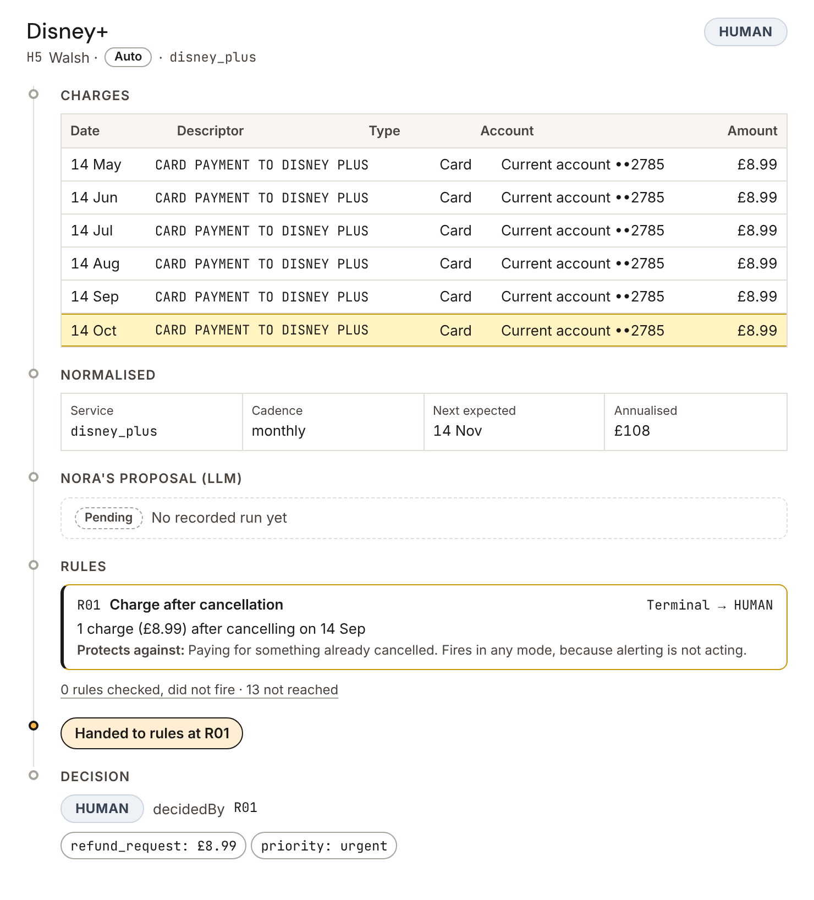
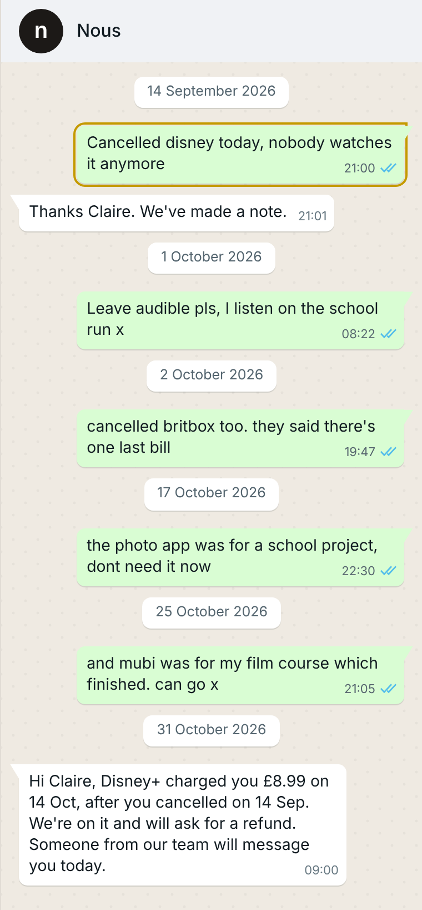
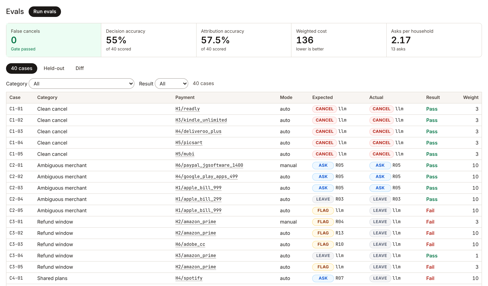

# Handover

I read the job description. This is where your issues are. This is how I've solved them before. This is how I'd solve them for you.

**The LLM proposes, the rules decide, and nothing gets cancelled that a member would want back.**

Live: https://cashpointsoulja.github.io/handover/

| Decision trace | WhatsApp pane | Evals |
|---|---|---|
|  |  |  |

Handover is the decision layer between the member-facing agent and the cancel button. It reads Open Banking transactions, finds recurring payments, lets an LLM propose what each one is and what to do, then runs 14 deterministic rules that can only make that proposal more cautious. Every decision shows where the LLM handed over to the rules, and why. The headline metric is false cancels = 0.

## Run it

```bash
npm install
```

```bash
npm run dev
```

```bash
npm test
```

```bash
npm run eval
```

- `npm run dev` opens the console on H1's unidentified £9.99 Apple charge.
- `npm test` runs the engine unit tests (a firing and a non-firing test for every rule) and the design-token contrast checks.
- `npm run eval` replays recorded proposals, scores the 40 eval cases and the 10 held-out cases, and writes [docs/test-results.md](docs/test-results.md).
- `npm run eval -- --compare evals/results/<file>.json` prints the per-case diff and fails if weighted cost went up.
- `npm run eval:live` re-runs the classifier against a real model and records new proposals. It needs `LLM_BASE_URL`, `LLM_API_KEY` and `LLM_MODEL` locally, and never runs in CI or the browser.
- `npm run eval:export -- --pass 1` and `npm run eval:import -- <file> --model "<label>"` record proposals without a key: run the exported prompts in a chat and import the answers. The current proposals were recorded from a language-model run in a chat interface on 2026-11-04; not an API run; not production accuracy; they are labelled `chat-recorded`. See [fixtures/proposals](fixtures/proposals/README.md).

## Layout

```
engine/     pure TypeScript: ingest, normalise, detect, gate, decide, message
config/     rules.yaml, merchants.yaml, prices.yaml, policies.yaml, messages.yaml
fixtures/   households/<id>/{household,transactions,chat}.json, proposals/
evals/      cases/, heldout/, results/, runner.ts, live.ts
src/        the console UI
design/     brand.md, the design sheet
docs/       one page each
```

## Docs

- [PRD](docs/prd.md)
- [Five whys](docs/five-whys.md)
- [Jobs to be done](docs/jtbd.md)
- [Metrics](docs/metrics.md)
- [Test plan](docs/test-plan.md) and [test results](docs/test-results.md)
- [Viability](docs/viability.md)
- [Roadmap v2](docs/roadmap-v2.md)
- [Demo script](docs/demo-script.md)
- [Design sheet](design/brand.md)

Sample households and transactions, hand-built for this concept.

An independent concept by Ayo Ahmed. Not affiliated with Nous.
